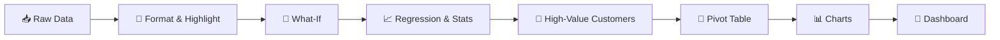

<div align="center">

# 📊 PR. 2 Analyzer

### From raw data to decision-ready dashboard — in Excel


**Conditional Formatting · What-If · Regression · Descriptive Stats · INDEX/MATCH · Pivot · Charts**

[Overview](#-overview) •
[Topics](#-topics-covered) •
[Workflow](#-project-workflow) •
[Tasks](#-task-breakdown) •
[Formulas](#-formula-cheat-sheet) •
[Dashboard](#-dashboard--insights) •
[Checklist](#-deliverable-checklist)

</div>

---

## 🎯 Overview

> **Goal:** Analyze customer and sales data to find top customers, measure how discounts change profit, model the Sales → Profit relationship, and present everything in one clean dashboard.

| 🧩 Item | 📌 Detail |
|:--|:--|
| **Project** | PR. 2 Analyzer |
| **Tool** | Microsoft Excel (365 recommended) |
| **Add-in** | Analysis ToolPak |
| **Tasks** | 10 |
| **Deliverable** | Completed worksheet with required formulas in the respective sheets |

---

## 🧠 Topics Covered

<table>
<tr>
<td width="50%" valign="top">

**🎨 Visualization & Formatting**
- Conditional Formatting
- Symbols / Arrows in Custom Formatting
- Bar, Line & Pie Charts
- Pivot Table with Dashboard

</td>
<td width="50%" valign="top">

**📐 Analysis & Statistics**
- WHAT-IF Analysis
- Linear Regression (ToolPak)
- Descriptive Stats & Histogram
- Advanced Descriptive Analytics

</td>
</tr>
<tr>
<td valign="top">

**🔎 Lookup & Functions**
- High-Value Customers (`GROUPBY`, `INDEX`, `MATCH`)
- Timestamp with `NOW()`

</td>
<td valign="top">

**📖 Communication**
- Data Storytelling
- Insight Summary Dashboard

</td>
</tr>
</table>

---

## 🔄 Project Workflow



---

## 🗂️ Workbook Structure

> Rename to match your final workbook.

| 📄 Sheet | 🎯 Purpose |
|:--|:--|
| `Instructions` | Topics, tasks, deliverable |
| `Data` | Raw dataset |
| `Conditional Formatting` | Top 10 customers highlighted |
| `What-If` | Discount vs. total profit |
| `Regression` | Profit vs. Sales model |
| `Descriptive Stats` | Summary stats + histogram |
| `Growth Arrows` | Monthly growth ▲▼ |
| `Timestamp` | `NOW()` column |
| `High-Value Customers` | INDEX / MATCH lookup |
| `Pivot` | Sales by region & product |
| `Charts` | Bar, line, pie KPIs |
| `Dashboard` | Final insight summary |

---

## ✅ Task Breakdown

<details open>
<summary><b>1️⃣ Conditional Formatting — Top 10 Customers</b></summary>

<br>

Highlight the top 10 customers by total purchase.

1. Select the *Total Purchase* column
2. **Home → Conditional Formatting → Top/Bottom Rules → Top 10 Items**
3. Set count to `10`, pick a fill color

</details>

<details>
<summary><b>2️⃣ What-If Analysis — Discount vs. Profit</b></summary>

<br>

Model: `Profit = Sales × (1 − Discount) − Cost`

- **Data → What-If Analysis → Data Table** (or *Scenario Manager* / *Goal Seek*)
- Vary the discount rate and observe total profit

</details>

<details>
<summary><b>3️⃣ Linear Regression — Profit vs. Sales</b></summary>

<br>

1. **File → Options → Add-ins → Analysis ToolPak**
2. **Data → Data Analysis → Regression**
3. Y Range = **Profit**, X Range = **Sales**
4. Tick *Labels*, *Residuals*, *Line Fit Plots*
5. Interpret **R²**, **coefficients**, **p-value**

</details>

<details>
<summary><b>4️⃣ Descriptive Statistics</b></summary>

<br>

- **Data → Data Analysis → Descriptive Statistics**
- Tick *Summary statistics*, output to a new sheet
- Add a **Histogram** for the sales distribution

</details>

<details>
<summary><b>5️⃣ Up / Down Arrows on Monthly Sales Growth</b></summary>

<br>

```excel
=(C3 - C2) / C2
```

Custom number format:

```
[Color10]▲ 0.0%;[Red]▼ 0.0%;0.0%
```

Or use **Conditional Formatting → Icon Sets → Directional**.

</details>

<details>
<summary><b>6️⃣ Timestamp Column</b></summary>

<br>

```excel
=NOW()
=TEXT(NOW(), "dd-mmm-yyyy hh:mm:ss")
```

> ⚠️ `NOW()` is volatile and updates on every recalculation. For a static value use **Ctrl + ;** (date) or **Ctrl + Shift + ;** (time).

</details>

<details>
<summary><b>7️⃣ Identify High-Value Customers</b></summary>

<br>

1. Aggregate total purchase per customer (`GROUPBY`, `SUMIFS`, or Pivot)
2. Pull top values with `LARGE`
3. Return names with `INDEX` + `MATCH`
4. Apply **Data → Filter** above your threshold

</details>

<details>
<summary><b>8️⃣ Pivot Table — Sales by Region & Product</b></summary>

<br>

- **Insert → PivotTable** from `Data`
- Rows: **Region** · Columns: **Product** · Values: **Sum of Sales**
- Add **Slicers** for interactivity

</details>

<details>
<summary><b>9️⃣ Charts for KPIs</b></summary>

<br>

| Chart | Best for |
|:--|:--|
| 📊 **Bar / Column** | Compare regions or products |
| 📈 **Line** | Monthly sales trend |
| 🥧 **Pie** | Share of sales by category |

</details>

<details>
<summary><b>🔟 Dashboard</b></summary>

<br>

Combine the Pivot Table, KPI cards, charts, and slicers on one sheet, plus a short **Key Takeaways** box.

</details>

---

## 🧾 Formula Cheat Sheet

| 🔧 Purpose | 🧮 Formula |
|:--|:--|
| Top-N value | `=LARGE(TotalPurchase, n)` |
| Customer for Top-N | `=INDEX(Customer, MATCH(LARGE(TotalPurchase, n), TotalPurchase, 0))` |
| Total per customer | `=SUMIFS(Sales, Customer, A2)` |
| Monthly growth | `=(C3-C2)/C2` |
| Timestamp | `=NOW()` |
| Group & sum (365) | `=GROUPBY(Customer, Sales, SUM)` |

> Replace range names with the actual ranges in your workbook.

---

## 🧭 Dashboard & Insights

The dashboard answers five questions:

| # | Question | Visual |
|:-:|:--|:--|
| 1 | Who are the top customers and what share of revenue do they hold? | 🏆 Ranked table |
| 2 | How does a discount change affect profit? | 🔮 What-If table |
| 3 | How strongly are Sales and Profit related? | 📈 Regression + R² |
| 4 | Which regions and products lead or lag? | 🧮 Pivot + bar chart |
| 5 | How did sales trend month to month? | 📉 Line chart with ▲▼ |

---

## 🚀 How to Use

1. Open the workbook in **Microsoft Excel**
2. Enable **Analysis ToolPak** (*File → Options → Add-ins → Manage Excel Add-ins → Go*)
3. Review the `Data` sheet
4. Work through each task sheet in order
5. **Data → Refresh All** after any data change
6. Open `Dashboard` for the summary

---

## ☑️ Deliverable Checklist

- [x] Top 10 customers highlighted
- [x] What-If analysis completed
- [x] Regression generated and interpreted
- [x] Descriptive statistics generated
- [x] Growth arrows applied
- [x] Timestamp column added
- [x] High-value customers identified
- [x] Pivot Table created
- [x] Bar, line, and pie charts added
- [x] Dashboard summarized

---

<div align="center">

### 👤 Author

**Your Name** · Your Course / Batch · October 2026

*Built with Microsoft Excel* ❤️

</div>
